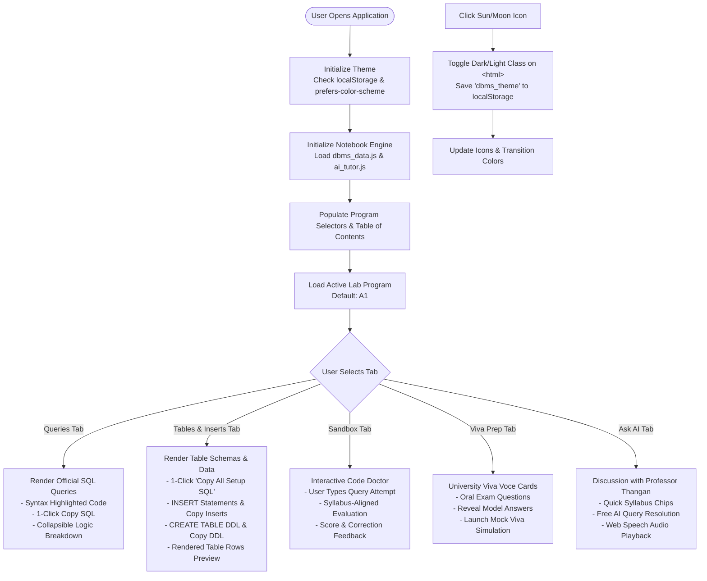

# SQL Lab Notebook — Interactive DBMS Lab Guide & AI Tutor

> A modern, distraction-free, responsive interactive learning notebook for all 14 DBMS SQL & PL/SQL lab programs. Complete with schemas, INSERT values, queries, viva prep, and Professor Thangan AI.


---

## Key Features

- **Full DDL Schemas & INSERT Values**: Complete `CREATE TABLE` statements with constraints (`PRIMARY KEY`, `FOREIGN KEY`, `CHECK`, `NOT NULL`) and executable `INSERT INTO` statements for all tables with 1-click copying.
- **⚡ 1-Click "Copy All Setup SQL"**: Quickly generate and copy the combined DDL and DML setup script for any experiment to set up Oracle SQL*Plus, SQL Developer, or MySQL in seconds.
- **☀️/🌙 Instant Dark & Light Mode**: Seamless theme toggle with Obsidian Dark and Clean Slate Light themes, persisted via `localStorage` and respecting system preferences.
- **📱 Mobile-First Segmented Navigation**: Eliminates text clutter and endless scroll fatigue on phones via dedicated view tabs (`Queries`, `Tables & Inserts`, `Sandbox`, `Viva Prep`, `Ask AI`) and docked thumb navigation.
- **Interactive AI Tutor (Professor Thangan)**: Built-in pedagogical AI guide pre-loaded with the entire lab syllabus for syntax breakdown, clause explanations, and oral viva exam practice.
- **Interactive SQL Practice Sandbox**: In-browser code doctor to test queries with instant syllabus-aligned feedback and scoring.
- **University Viva Voce Preparation**: Flashcards with official oral exam questions and examiner model answers.
- **Multi-Tier AI Architecture**: 100% Free Cloud AI (Pollinations.ai), local rule-based Offline Knowledge Engine, and optional Google Gemini API support.

---

## Tech Stack

| Layer | Technologies |
| :--- | :--- |
| **Frontend Core** | HTML5, Modern ECMAScript (ES6+), Vanilla JavaScript (No heavy frameworks or node build steps) |
| **Styling & Theming** | Tailwind CSS (Class-based dark mode strategy), Custom CSS design system tokens |
| **Typography** | [Google Fonts](https://fonts.google.com/): `Inter` (UI & prose readability) & `Fira Code` (syntax & monospace code blocks) |
| **Iconography** | [Lucide Icons](https://lucide.dev/) (SVG vector icons) |
| **Markdown Parsing** | [Marked.js](https://marked.js.org/) (High-performance client-side markdown compiler) |
| **AI & NLP Layer** | Multi-tiered AI: Free Cloud AI (Pollinations.ai API), Google Gemini Pro/Flash API integration, and Offline Rule-Based Pedagogical Engine |
| **Audio Speech** | Web Speech API (Browser-native text-to-speech engine for audio tutoring) |
| **Persistence** | Browser `localStorage` (Theme preferences, AI engine selection, custom API keys, and session history) |

---

## Program Structure

```
dprj/
├── index.html          # Main single-page interactive application
│                       # (Responsive layout, segmented tabs, theme toggle, modals)
│
├── dbms_data.js        # Comprehensive syllabus database for all 14 programs
│                       # (DDL schemas, INSERT statements, sample rows, queries, viva Q&A)
│
├── ai_tutor.js         # Professor Thangan AI teaching & examination engine
│                       # (Prompt engineering, fallback cascades, Gemini/Pollinations/Offline)
│
├── vercel.json         # Static hosting configuration (clean URLs & route rules)
├── README.md           # Project architecture, lab curriculum, and technical documentation
├── .gitignore          # Git exclusion rules
└── Dbms Final Record.pdf # Source laboratory syllabus & experiment record
```

### Module Responsibilities

1. **`index.html`**:
   - Manages responsive layout across desktop, tablet, and mobile screens.
   - Hosts the **Dark/Light Theme Controller** with immediate head-script initialization (preventing FOUC).
   - Houses the **Segmented Tab Switcher** that cleanly isolates queries, tables, sandbox, and discussion on mobile devices.
   - Implements the modal controllers for the 14-program Table of Contents (Index), DBMS Cheatsheet, and Tutor Settings.

2. **`dbms_data.js`**:
   - Contains the canonical definitions for all 14 experiments.
   - For every table: provides table schema, column definitions, `createSql` (DDL), `insertSql` (DML values), and `sampleRecords` (tabular preview data).
   - For every query: stores problem statement, solution query, line-by-line explanation, key bullet points, and expected output.
   - Contains the university oral viva examination bank and theory concept summaries.

3. **`ai_tutor.js`**:
   - Defines `DBMSTeachingSystem`, encapsulating state, conversation history, and tutoring modes (`tutor`, `explainer`, `doctor`, `viva`).
   - Automatically handles provider selection and graceful degradation:
     - Primary: Free Cloud AI (Pollinations.ai - zero configuration required).
     - Secondary: Custom Google Gemini API (if user provides API key).
     - Fallback: Local rule-based offline pedagogical engine.
   - Integrates browser speech synthesis for audio explanations.

---

## Program Flow



### Execution Lifecycle

1. **Bootstrap & Hydration**:
   - The `<head>` script immediately checks `localStorage` or `window.matchMedia('(prefers-color-scheme: dark)')` and adds the `dark` class before DOM painting, preventing visual flashing.
   - `initNotebook()` registers event handlers, loads the active lab from `DBMS_PROGRAMS`, and activates the **Queries** tab by default.

2. **Tabbed Content Rendering**:
   - Content is dynamically segregated into distinct tabs (`queries`, `tables`, `practice`, `viva`, `discussion`, `all`).
   - On mobile phones, tapping a navigation button displays the chosen panel without requiring vertical scrolling through unrelated sections.

3. **Database Setup Generation**:
   - In the **Tables & Inserts** panel, students can copy individual INSERT statements or click **"Copy All Setup SQL"** to generate an end-to-end setup script (`CREATE TABLE` + `INSERT INTO` + `COMMIT`) ready for immediate execution in any SQL client.

4. **AI Tutoring & Practice Validation**:
   - When a student submits a query to the Code Doctor, `ai_tutor.js` injects the specific lab's schema and model solution into the prompt.
   - The response is parsed client-side using `marked.js` into syntax-highlighted HTML with optional text-to-speech output.

---

## Lab Curriculum

### Part A: SQL Table DDL & Relational Queries
1. **A1: Employee Table & Search Queries**
   - *Schema*: `EMPLOYEE` table with `PRIMARY KEY`, `CHECK` constraints on department, designation, and gender.
   - *Concepts*: `LIKE '%Raj'`, `BETWEEN`, `DISTINCT`, `GROUP BY`, and `HAVING` aggregations.
2. **A2: Client Table Surgery (CTAS & DDL Alterations)**
   - *Schema*: `CLIENT` table with Primary Key and `CHECK (client_no LIKE 'C%')`.
   - *Concepts*: CTAS table cloning (`client1`), empty structure creation (`WHERE 1=2`), `ALTER TABLE ADD penalty`, conditional `UPDATE`, `RENAME`, and `DROP TABLE`.
3. **A3: Book Library Records & String Filtering**
   - *Schema*: `BOOK` table with primary key and year/price constraints.
   - *Concepts*: Pattern matching with single-character wildcard (`LIKE '_a%'`), multi-condition sorting (`ORDER BY year DESC`), `ALTER TABLE MODIFY`, set exclusions (`NOT IN`), and conditional `DELETE`.
4. **A4: Sales Team Hierarchy (Self-Join & Date Math)**
   - *Schema*: `SALES` table with age constraint (`TRUNC(MONTHS_BETWEEN(join_date, date_birth)/12) >= 18`).
   - *Concepts*: Subqueries with `AVG()`, commission recalculation, self-joins (`sales s JOIN sales m ON s.manager_name = m.sname`), and date arithmetic for employment tenure (10+ years).
5. **A5: Sales Performance (Composite Keys & Subqueries)**
   - *Schema*: `SALES_DETAILS` table with composite primary key `(sno, month)`.
   - *Concepts*: Target vs. actual comparisons, commission calculations, correlated subqueries (`NOT IN` to identify salespersons who never reached targets), and month-based filtering.
6. **A6: Suppliers & Inventory Joins**
   - *Schema*: `SUPPLIERS` and `CITEMS` relational tables linked via foreign key referential integrity.
   - *Concepts*: Multi-table inner joins with composite ordering (`ORDER BY scity ASC, iquantity DESC`), subqueries for supplier lookups, and inventory re-ordering via CTAS (`neworder`).
7. **A7: Product Sales Analytics & UNION Operations**
   - *Schema*: `PRODUCT_DETAIL` and `PURCHASED_DETAIL` relational tables.
   - *Concepts*: Aggregate spend calculations, `UNION` query combining inventory shortfalls with low sales volume, customer purchase history, and profit margin computation.

### Part B: PL/SQL Programs, Packages & Database Triggers
8. **B1: Bank Debit & Built-in Exception Handling**
   - *Schema*: `BANK` table with balance integrity check (`bal > 500`).
   - *Concepts*: PL/SQL block with debit deduction logic, user input binding, and `NO_DATA_FOUND` exception handling.
9. **B2: Inventory Purchase & User-Defined Exceptions**
   - *Schema*: `STOCK_DETAIL` table with positive stock check (`qty_avl > 0`).
   - *Concepts*: User-defined exception declaration (`low_stock EXCEPTION`), programmatic `RAISE low_stock`, and transaction validation.
10. **B3: Book Selling Price Calculation (Explicit Cursor)**
    - *Schema*: `BOOK` table with categorized price structures.
    - *Concepts*: Explicit cursor lifecycle (`CURSOR`, `OPEN`, `FETCH`, `%NOTFOUND`, `CLOSE`), category-based discount rules, and selling price computation.
11. **B4: Employee Payroll Procedure (Cursor FOR Loop & OUT Params)**
    - *Schema*: `EMPLOYEE` table with basic salary records.
    - *Concepts*: Stored Procedure `paybill` with `IN` and `OUT` parameters for DA, HRA, PF, TAX, GROSS, and NET, invoked via a Cursor `FOR` Loop across all employee rows.
12. **B5: Inventory Package (PCK_ITEM Spec & Body)**
    - *Schema*: `ITEM_MASTER` and `ITEM_TRANS` tables.
    - *Concepts*: Package specification (`chk_item` function, `proc_item` procedure) and package body implementing transaction auditing, stock deductions, and `COMMIT`.
13. **B6: Mathematics Package (Factorial, nCr & nPr)**
    - *Schema*: Algorithmic PL/SQL subprograms (zero table dependencies).
    - *Concepts*: Package specification and body containing iterative/recursive `factorial` function, permutation procedure (`calc_nPr`), and combination procedure (`calc_nCr`).
14. **B7: Database Triggers (Audit & Stock Auto-Sync)**
    - *Schema*: `MASTER`, `SALES`, and `NEWSTOCK` tables.
    - *Concepts*: Row-level `AFTER INSERT` trigger (`trg_after_sales`) to auto-increment sales and decrement stock, and multi-predicate `AFTER INSERT OR UPDATE OR DELETE` trigger (`trg_dml_newstock`) utilizing `:NEW` and `:OLD` correlation qualifiers.

---

## Creator

- **Adithya**
- **Instagram**: [@adi_cazz__7](https://instagram.com/adi_cazz__7)
- **GitHub**: [code-by-adi7](https://github.com/code-by-adi7)
